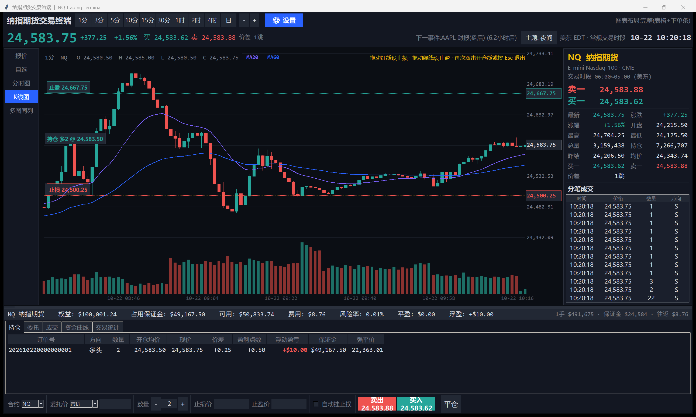
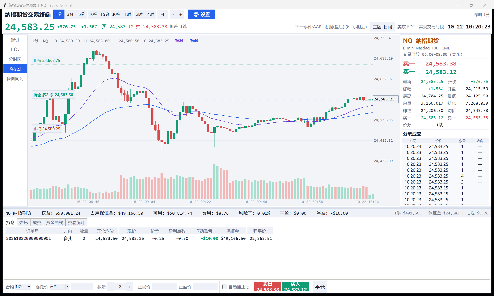
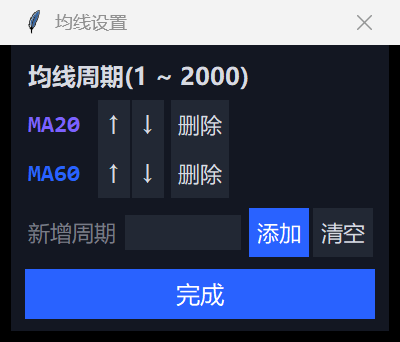
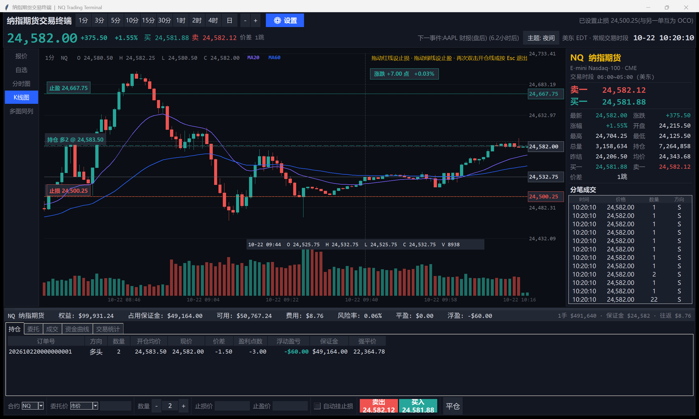
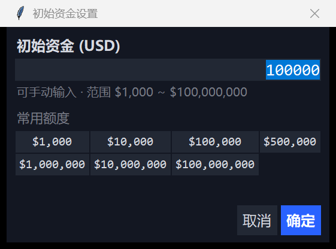
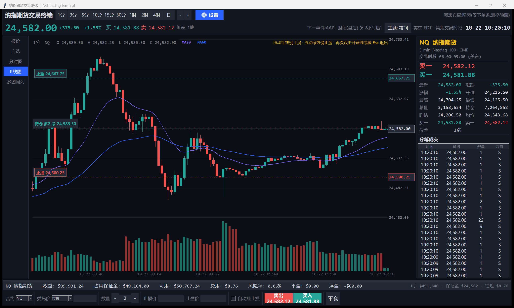
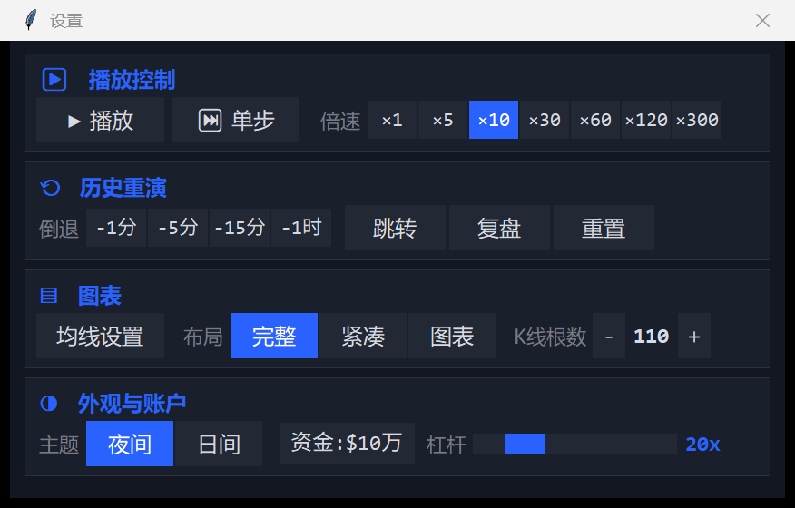
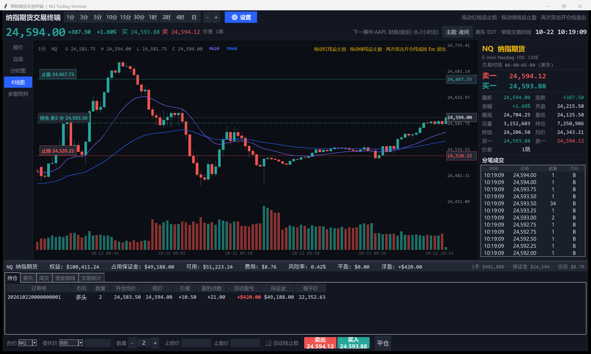
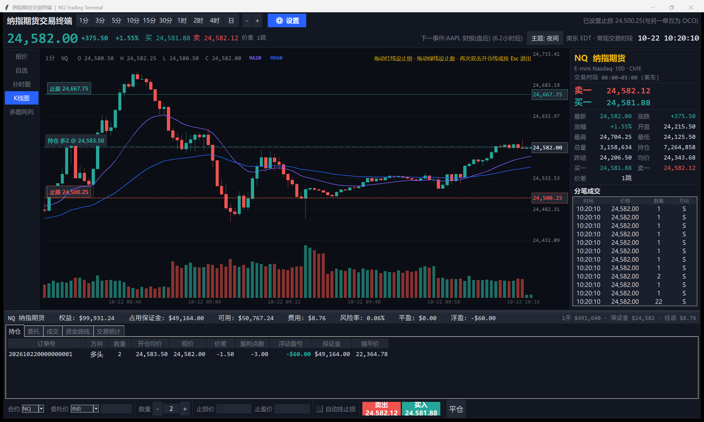

# NQSim · 纳指期货交易终端

[](https://github.com/super964/NQSim/releases/latest)
[](LICENSE)
[](https://www.python.org/)
[](#五从源码运行--重新打包)

一个可离线运行的 Windows 桌面程序,以专业期货交易终端的形态模拟 **纳斯达克100 指数交易**:
真实K线跳动、真实交易时段与节假日历、真实订单撮合与滑点、真实保证金与杠杆风控、真实资金曲线,
并支持训练时 **快进 / 倒退重演** 与 **日间 / 夜间主题一键切换**。

- **直接使用**:到 [Releases](https://github.com/super964/NQSim/releases/latest) 下载 `NQSim.exe`,双击即开,无需安装 Python、无需联网。
- **读代码**:纯 Python 标准库实现(`tkinter` 绘图),约 5300 行,**零第三方依赖**,`python main.py` 直接跑。





---

## 一、快速开始

1. 双击 `NQSim.exe`(单文件,无需安装 Python,无需联网)。
2. 打开即为 **夜间模式**,点右上角 `主题: 夜间` 按钮一键切换 **日间模式**。
3. 底部 **最下面一栏** 就是下单条:填手数 → 点 `卖出` / `买入`(按钮上直接显示当前盘口价)。
   持仓、委托、成交、资金曲线、交易统计在其上方的标签页里。
4. 顶部工具条只剩 **周期 / 缩放 / ⚙设置** 三样。播放、倍速、倒退、跳转、复盘、
   均线、布局、主题、初始资金、杠杆 **全部收在 `⚙ 设置` 面板里**。
5. 想看更多K线:设置面板里 `布局` 切到 `紧凑` / `图表`,
   或 **直接上下拖动图表与底部区之间的分隔条**。
6. 想加均线:设置面板里 `均线设置`,输入周期(1~2000)后 `添加`。
7. 想改本金:设置面板里 `资金:$10万`,可设 **$1,000 ~ $1亿** 之间的任意额度。
8. 想设止盈止损:持仓后 **在K线图上双击开仓线**,拖动红线/绿线即可。

| 快捷键 | 功能 |
|---|---|
| `F2` | 切换日间 / 夜间主题 |
| `F3` | 播放 / 暂停 |
| `Esc` | 退出止盈止损编辑模式 |

---

## 二、界面分区(仿专业期货终端)

```
┌ 顶部:纳指期货交易终端 | 1分 3分 5分 10分 15分 30分 1时 2时 4时 日 | - + | ⚙ 设置   │
├ 报价条:最新价 / 涨跌 / 买一 / 卖一 / 价差 │ 事件倒计时 │ 主题 │ 美东时钟        │
├────┬──────────────────────────────────────────┬────────────────────────────┤
│报价│                                          │ NQ 纳指期货                 │
│自选│            行情图(铺满整个上方)            │ E-mini Nasdaq-100 · CME    │
│分时│                                          │ 交易时段 06:00~05:00 (美东) │
│K线 │                                          │ 卖一 / 买一                 │
│多图│                                          │ 最新   涨跌 | 涨幅   开盘   │
│    │                                          │ 最高   最低 | 总量   持仓   │
│    │                                          │ 昨结   均价 | 买一   卖一   │
│    │                                          │ 价差                       │
│    │                                          │ ── 分笔成交 ──              │
├────┴────────── ══ 可拖动分隔条 ══ ─────────────┴────────────────────────────┤
│ 资金条:NQ 纳指期货 权益 / 占用保证金 / 可用 / 费用 / 风险率 / 平盈 / 浮盈        │
│ ┌ 持仓 │ 委托 │ 成交 │ 资金曲线 │ 交易统计 ──────────────────────────────────┐ │
│ │ 订单号 │ 方向 │ 数量 │ 开仓均价 │ 现价 │ 价差 │ 盈利点数 │ 浮动盈亏 │ 保证金 │ 强平价 │ │
│ └───────────────────────────────────────────────────────────────────┘ │
├──────────────────────────────────────────────────────────────────────────┤
│ 交易下单条(整幅最底部一栏):                                                  │
│ 合约[NQ▾] 委托价[市价▾] 数量[－][1][＋] 止损价[ ] 止盈价[ ] ☑自动挂止损        │
│ [卖出 24,537.88][买入 24,539.62] │ 平仓                                       │
└──────────────────────────────────────────────────────────────────────────┘
```

| 区域 | 说明 |
|---|---|
| 顶部工具条 | **周期按钮组**(1分~日,一键切换,各周期历史独立完整)、图表缩放、**⚙ 设置**(其余全部控制) |
| 报价条 | 最新价、涨跌、买一卖一与价差、事件倒计时、主题切换、美东时钟 |
| 左侧导航 | 报价 / 自选 / 分时图 / K线图 / 多图同列(均为可用视图) |
| 中部行情图 | K线主图(实时跳动)、成交量、**可自定义均线(1~2000 周期)**、持仓均价线、止损线、止盈线、十字光标、**悬停涨跌读数**、**双击开仓线拖拽设止盈止损** |
| 右侧盘口 | 合约抬头 / 交易时段 / **卖一·买一**(大号红绿)/ **两列对齐的行情统计**(最新·涨跌·涨幅·开盘·最高·最低·总量·持仓·昨结·均价·买一·卖一·价差)+ **分笔成交**(时间/价格/**手数**/方向,方向按 uptick 规则继承) |
| 底部资金条 | 权益、占用保证金、可用、费用、风险率、平盈、浮盈,右端显示 1 手名义 / 保证金 / 往返成本 |
| 底部交易区 | **最底部一栏**交易下单条(合约/委托价/数量/止损价/止盈价/自动挂止损/买多买空/平仓)+ 持仓、委托、成交、资金曲线、交易统计五个标签页 |

### 鼠标滚轮缩放

| 操作 | 效果 |
|---|---|
| 在 **K线图** 上滚动 | 向上 = 放大(可见K线变少、单根变宽);向下 = 缩小(可见K线变多、单根变窄) |
| 在 **分时图** 上滚动 | 缩放可见分时点数(30 ~ 1500) |
| 在 **资金曲线** 上滚动 | 缩放可见净值采样点数(30 ~ 5000) |

顶部 `－ / ＋` 按钮等价于对 K线图做一次缩小 / 放大。

### 鼠标拖动平移(回看历史)

| 操作 | 效果 |
|---|---|
| 在图表上 **按住左键左右拖动** | 向右拖 = 向前回看更早的K线;向左拖 = 回到更新的行情(拖动过程是像素级实时跟随,松开即对齐) |
| 拖到最右侧 | 自动回到最新K线(实时形成的K线重新出现在右端) |
| 切换周期 | 自动回到该周期的最新K线 |

拖动时鼠标指针变为十字抓取形态,状态栏实时显示"已向左回看 N 根"。
K线图会按需向后延展历史窗口(一次预取 600 根),因此可以连续向左回看很久。

### 均线设置(周期 1 ~ 2000)

点击 `⚙ 设置` 面板里的 `均线设置`,弹出 **均线设置** 对话框:



| 操作 | 效果 |
|---|---|
| `新增周期` 输入框 → `添加` | 新增一条均线,周期取值范围 **1 ~ 2000**(超出范围会提示) |
| `↑` / `↓` 按钮 | 调整均线在列表中的顺序,**同时决定配色**(依次为紫、蓝、黄、青、红、灰) |
| `删除` 按钮 | 移除该条均线 |
| `清空` 按钮 | 移除全部均线 |
| `完成` | 关闭对话框,立即生效 |

- 最多同时显示 **6 条**均线,默认 `MA20 / MA60`。
- 每条均线在 K线图标题右侧显示图例(如 `MA20`),颜色与图中曲线一致。
- 均线按 **EMA** 递推计算,并且 **在完整历史序列上递推**(而非只算可见窗口),
  因此 `MA200 / MA2000` 这类长周期均线的形态是正确的,不会因为"只从屏幕左边缘起算"而严重失真。
- 均线随周期切换、缩放、平移实时重绘;切换周期不会丢失你的配置。

### K线悬停读数(涨跌比例 + 该K线价格)



鼠标在 K线图上移动时:

| 位置 | 显示内容 |
|---|---|
| 图表底部信息条 | 该根K线的时间 + `O / H / L / C` + 成交量 `V` |
| 光标右侧浮动框 | **该K线的涨跌**:点数(如 `涨跌 +8.75 点`)+ 比例(如 `+0.04%`),涨绿跌红 |
| **右侧价格轴** | 标出 **该根K线的收盘价**(带边框的价格标签),实体较高时另画一条开盘价虚线 |
| 十字光标 | 竖线锁定所在K线,横线跟随鼠标 |

- 涨跌以 **前一根K线的收盘价** 为基准(第一根K线用其开盘价)。
- 所有历史K线与实时行情都 **严格贴合最小变动价位**(NQ 为 0.25),
  因此涨跌点数一定是整跳值,不会出现 `8.89` 这类无法成交的报价。

### 初始资金设置($1,000 ~ $1亿)



点击 `⚙ 设置` 面板里的 `资金:$10万` 按钮,弹出 **初始资金设置** 对话框:

| 操作 | 效果 |
|---|---|
| 输入框 | **手动输入** 任意金额,范围 **$1,000 ~ $100,000,000**;超出范围会就地提示 |
| 常用额度按钮 | 一键填入 $1,000 / $10,000 / $100,000 / $500,000 / $1,000,000 / $10,000,000 / $100,000,000 |
| `确定` | 应用新本金并 **重置账户**(持仓、成交、净值曲线清空,行情重新生成) |
| `取消` | 关闭,不做任何改动 |

- **默认初始资金 $100,000(10 万)**,与工具条按钮上的文字同步显示。
- 改了本金后,保证金占用、风险率、可用资金全部按新本金重算;
  杠杆、止损、止盈等下单设置不受影响。

### 布局调节(把图表放大)



图表与底部区之间有一条 **可拖动分隔条**(鼠标指针对准会变成上下箭头)。

| 操作 | 效果 |
|---|---|
| 设置面板里的 `布局` | 在 **完整 → 紧凑 → 图表** 三档之间切换(当前档位高亮) |
| `完整` | 资金条 + 持仓/委托/成交表格(自然高度)+ 底部下单条(默认档) |
| `紧凑` | 表格压到约 3 行高度,下单条保留,图表进一步变大 |
| `图表` | 隐藏表格,只留资金条 + 底部下单条,K线图占满整个下方 |
| **拖动分隔条上下移动** | 自由调整图表与底部区的高度比例,拖动后自动进入 `自定义` 档 |

拖动分隔条时,松手即刻重排并按新的高度重新绘制图表(不需要重启),
同时会恢复被隐藏的表格。每档的目标高度都已按当前屏幕 DPI 换算。

### 交易下单条(最底部一栏)

下单区被压成 **整幅界面最底部的一栏**,所有控件横向排在一行里,
因此不再占用图表高度,也不会出现按钮被裁切/遮挡:

```
合约[NQ▾] │ 委托价[市价▾] │ 数量[－][1][＋] │ 止损价[ ] │ 止盈价[ ] │
☑自动挂止损 │ [卖出 24,537.88][买入 24,539.62] │ 平仓
```

- `卖出` / `买入` 为常规尺寸,按钮上直接显示当前盘口价。
- `平仓` 按钮字号与点击区域调大了一档,方便高频操作点得准。
- 委托价选 `限价` / `止损限价` 时,右侧的委托价格输入框才会高亮(其余情况置灰)。
- **杠杆滑块已移入 `⚙ 设置` 面板**,底部资金条里的杠杆字样也已去掉。
- 资金条右端显示 `1手名义 · 保证金 · 往返成本`,方便估算手数。
- 止盈 / 止损除了在下单条里手填,还可以 **在K线图上双击开仓线直接拖拽设置**(见下文)。

---

## 二·一、设置面板(顶部工具条只留核心图表控制)



顶部工具条只保留 **周期切换 / 图表缩放 / ⚙ 设置**,其余控制全部收进设置面板,
像专业交易软件那样把"行情操作"与"参数调节"分开:

| 分区 | 内容 |
|---|---|
| ▶ **播放控制** | 播放 / 暂停、单步逐根、倍速 `×1 ~ ×300` |
| ⟲ **历史重演** | 倒退 `-1分 / -5分 / -15分 / -1时`、跳转、复盘 ↔ 重来、重置 |
| ▤ **图表** | 均线设置、布局 `完整 / 紧凑 / 图表`、K线可见根数 `－ ＋` |
| ◑ **外观与账户** | 主题 `夜间 / 日间`、初始资金(`$10万` 按钮)、**杠杆滑块** |

- 面板是 **非模态** 的:打开着也能继续看盘、拖动分隔条、下单。
- 面板里的按钮会实时反映当前状态(倍速高亮、当前布局高亮、当前主题高亮)。
- 杠杆滑块已从底部下单条移到此处;**底部资金条里的杠杆字样也已去除**。
- 换主题会整体重建界面,设置面板会自动重开并保持当前选中状态。

---

## 二·二、在K线图上直接设止盈止损(双击开仓线)



持仓之后,在 K线图上 **双击那条持仓均价线(开仓线)**,就进入止盈止损编辑模式:

| 操作 | 效果 |
|---|---|
| **双击开仓线** | 进入编辑模式,图表上出现 **红色止损线** 与 **绿色止盈线**,都带价格标签与右侧价格轴标注 |
| **拖动红线** | 把止损价拖到目标价位,松手即挂出 **止损市价单** |
| **拖动绿线** | 把止盈价拖到目标价位,松手即挂出 **限价止盈单** |
| **拖动开仓线** | 止损 / 止盈保持相对距离整体跟随 |
| **再次双击开仓线** 或 `Esc` | 退出编辑模式 |

- 初次进入会按现价自动给出止损(-0.3%)与止盈(+0.3%)参考位,可直接拖动微调。
- 止损 / 止盈 **互为 OCO(括号单)**:先成交的一单自动撤销另一单,不会两头都成交。
- 拖动过程中价格实时对齐最小变动价位(NQ 为 0.25)。
- 持仓平掉后,这两张挂单会自动撤销,不会反向开仓。
- **止盈或止损一旦成交**(持仓归零),K线图上的 **开仓线 / 止损线 / 止盈线会自动消失**,
  编辑模式同时自动退出,图上不会残留任何过期价位线。

---

## 二·三、持仓明细:订单号 / 价差 / 盈利点数



持仓表每一行都带 **仿真实平台的订单编号**(与委托表一致):

| 列 | 说明 |
|---|---|
| **订单号** | 一串 **18 位纯数字**,形如 `202610220000000001`(前 8 位交易日 + 后 10 位当日递增流水),MNQ / NAS100 同样规则 |
| 方向 / 数量 | 多头 / 空头,手数 |
| 开仓均价 / 现价 | 本笔开仓的成交价与当前价 |
| **价差** | `(现价 − 开仓均价)`,按持仓方向取符号,单位为点 |
| **盈利点数** | `价差 × 数量`,即这笔单一共赚/亏了多少点(NQ 1 点 = $20) |
| **浮动盈亏** | 金额;**盈利显示为红色,亏损显示为绿色**(中文行情习惯) |
| 保证金 / 强平价 | 占用保证金与精确解算的强平价 |

> 持仓表是 **逐格绘制** 的表格(不是 Treeview):**只有"浮动盈亏"那一格** 会随盈亏变红/变绿,
> 其余格子(订单号、方向、数量、均价、现价、价差、盈利点数、保证金、强平价)始终保持统一配色,
> 整行不会变色。

委托表与成交日志里的订单同样使用这套编号,便于和期货公司 / 交易所的报单号对照。

---

### 高分屏适配(为什么不再发糊)

Windows 在 125% / 150% / 175% 缩放下,若程序**没有声明 DPI 感知**,
系统会按 96 DPI 渲染整个窗口,再把位图拉伸放大 —— 文字与线条全部发虚。

本程序已做三件事:

1. **声明 Per-Monitor V2 DPI 感知**:打包进 exe 的 `app.manifest` 里写明
   `dpiAware=true/pm` + `dpiAwareness=permonitorv2`,源码运行时由
   `SetProcessDpiAwareness(2)` 兜底。
2. **强制 Tk 按真实 DPI 换算字号**(`tk scaling = DPI/72`):
   9pt 就是物理 9pt,100% 和 200% 屏幕上的字一样大、一样锐利。
3. **所有像素级尺寸按缩放系数换算**(窗口大小、盘口面板宽、表格行高、
   图表刻度留白),同时**字号整体上调一档**(最小 8pt → 10pt,图表刻度 8pt → 10pt),
   保证在 150% 屏上依旧一眼可读。

---

## 二·四、右侧盘口面板(真实排版)与分笔成交(大小单分布)

最右侧的 **纳指期货盘口** 已按真实交易面板重排,读数不再东倒西歪:

```
┌ NQ  纳指期货 ──────────────────────┐
│ E-mini Nasdaq-100 · CME             │
│ 交易时段 06:00~05:00 (美东)          │
│ ──────────────────────────────────  │
│ 卖一   24,761.38                    │   ← 卖一红 / 买一绿,大号数字
│ 买一   24,761.12                    │
│ ──────────────────────────────────  │
│ 最新    24,761.25   │ 涨跌     +89.00│
│ 涨幅      +0.36%    │ 开盘   24,672.25│
│ 最高    24,788.50   │ 最低   24,640.00│
│ 总量   3,598,681    │ 持仓   8,277,966│
│ 昨结    24,672.25   │ 均价   24,702.16│
│ 买一    24,761.12   │ 卖一   24,761.38│
│ 价差         1跳                     │
│ ──────────────────────────────────  │
│ 分笔成交                            │
│ 14:32:08  24,761.25    1     B      │
│ 14:32:07  24,761.00    3     S      │
│ 14:32:05  24,761.25   24     B      │   ← 大单
└─────────────────────────────────────┘
```

要点:

1. **两列对齐**:统计区是 `名称-数值-名称-数值` 的四列网格,数值列统一右对齐,
   标签列左对齐,读数不会挤在一起,也不会参差不齐。
2. **分节**:合约抬头 / 交易时段 / 卖一买一 / 行情统计 / 分笔成交 之间用细分隔线分区。
3. **分笔成交的手数有大小单分布**,不再是清一色的 `1`:

   | 手数区间 | 出现概率 | 说明 |
   |---|---|---|
   | 1 手 | 79% | 最小成交 |
   | 2~3 手 | 12% | 普通小单 |
   | 4~9 手 | 6% | 中单 |
   | 10~25 手 | 2.4% | 大单 |
   | 26~120 手 | 0.6% | 机构大单 |

   平均每笔约 **2.3 手**;K线成交量、成交量柱、会话总量、VWAP 全部按 **同一套手数口径** 统计,
   历史合成行情与实时行情完全一致。

---

## 二·五、K线周期的实现(高周期为什么不再是"巨粗方块")

上一版在高周期(10分/15分/1时)会出现 K线 被拉成整屏宽度的 **粗方块**,根因有两处,现已全部修复:

1. **历史深度不足**:旧版启动只预填 45 分钟行情,切到 1 小时周期时全屏只有 3~4 根K线,
   自然被拉成方块。现在启动时用 **快速历史生成器** 一次性合成 **190 天历史**
   (远期按小时粒度、近 72 小时按 10 秒粒度,与逐笔引擎同参数同形态),耗时约 0.5 秒。
2. **跨休市分组越界**:旧版按"底仓根数"推算周期分组,一旦历史跨越 17:00 收盘或周末缺口就会
   算错甚至抛 `IndexError`。现在改为 **按时间戳分组**,休市缺口安全。

为此,K线数据采用 **三级聚合层**,每层各自保留足够长的历史,任意周期切换都是零延迟:

| 聚合层 | 粒度 | 容量 | 服务的显示周期 |
|---|---|---|---|
| 底仓 | 10 秒 | 36000 根(≈100 小时) | 1分 / 3分 / 5分 / 10分 / 15分 / 30分 |
| 小时层 | 1 小时 | 6000 根(≈250 天) | 1时 / 2时 / 4时 |
| 日线层 | 美东自然日 | 800 根(≈2 年) | 日 |

此外,K线图对 **单根像素宽度设上限(15px)** 并 **右对齐留白**,
即使数据不足以铺满窗口,也只会在右侧留下空白,不会再出现被拉伸的巨型方块。

---

## 三、真实性设计

### 1. 交易日历与时间
- **CME Globex** 真实时段:美东周日 18:00 开盘 → 周五 17:00 收盘,每日 17:00–18:00 维护休市,周末全休市。
- 美国法定假日(元旦/MLK/总统日/耶稣受难日/阵亡将士纪念日/六月节/独立日/劳动节/感恩节/圣诞)全天休市;
  节假日前一个交易日 **13:00(美东)提前收盘**;感恩节次日、平安夜、7月3日同样提前收盘。
- 自行实现美东时区与 **EST/EDT 夏令时**,Windows 无需安装 tzdata。
- 夜盘开盘有 **隔夜跳空**(均值 11bp,10% 概率 18–45bp 大幅跳空)。
- 顶部时钟始终显示美东时间与 EST/EDT 标识,时段标签区分 `夜盘 / 盘前 / 常规交易时段 / 盘后 / 休市`。

### 2. 价格生成(与真实纳指期货同量级)
- **逐笔成交**驱动,每笔带亚秒时间戳;**成交笔数与推进的仿真时间严格成正比**(泊松抽样),
  这是倍速真实生效、K线不失真的前提。
- **每笔成交带手数**:79% 为 1 手,其余按 2~3 / 4~9 / 10~25 / 26~120 手分布(平均约 2.3 手),
  分笔成交、成交量柱、会话总量、VWAP 全部使用同一套手数口径。
- **日内 U 型波动率**(开盘/收盘/夜盘开盘尖峰、午间低谷)+ **OU 过程驱动的波动聚集**(类 GARCH)。
- 日波动率标定 1.25%,4 小时区间约 300 点;1 分钟K线单根波幅中位约 9~13 点、成交量约 1200~4800 手 —— 与真实 NQ 相当。
- 价格严格贴合 0.25 最小变动价位;微观结构噪声量纲取最小变动价位,不会随机游走累积。
  **启动预填的 190 天历史同样按最小变动价位对齐**(缩放对齐当前价后会重新取整),
  因此任意周期下的涨跌幅点数都是整跳值。
- **宏观事件驱动**:非农、CPI、PPI、零售销售、核心PCE、ISM制造业/服务业、初请失业金(每周四)、
  FOMC 利率决议(美东14:00)、季度GDP、NVDA/AAPL/MSFT/TSLA/AMZN/META 盘后财报 ——
  事件时刻产生跳空,随后 20~90 分钟放大波动率,界面显示下一个事件倒计时。

### 3. 撮合与滑点(真实)
- 订单类型:**市价 / 限价 / 止损市价 / 止损限价**;支持 **开仓成交后自动挂保护性止损**(平仓后自动撤销)。
- **括号单(OCO)**:止损与止盈互为一组,先成交者自动撤销另一单;持仓平掉后整组撤销。
- **订单编号**仿真实平台格式:一串 **18 位纯数字**,形如 `202610220000000001`(前 8 位交易日 + 后 10 位当日递增流水)。
- **市价单在下一笔成交才成交**(真实下单延迟),按对手价 + 滑点成交。
- **吃单能力受限**:单笔可吸收手数随当时成交活跃度变化,大单自动 **分笔成交**,形成 VWAP 滑点。
- **滑点模型** = 半点差 + 冲击成本(平方根律) + 随机噪声,方向性作用于成交价。
- **价差** 随流动性变化:1 跳常态,开盘/尾盘/事件期间 2–3 跳。
- 限价单必须 **价格穿越** 才成交;止损单触发后按市价+滑点成交。

### 4. 资金管理与风控(真实)
- 合约规格真实:**NQ** 乘数 $20/点、最小跳动 0.25(=$5)、佣金 $2.09/手/边 + 交易所费用 $2.29/手/边(往返 $8.76/手);
  另提供 **MNQ**(乘数 $2)与 **NAS100 CFD**。
- **保证金 = 名义价值 / 杠杆**,杠杆 1~100x 可在持仓中实时调整,调整后立即重算并可能触发追保。
- **维持保证金 = 25% 初始保证金**;权益击穿维持保证金 → **市价强平**(惩罚性滑点)。
- 权益低于占用保证金 → **追保减仓**;持仓面板显示精确解算的 **强平价**。
- **隔夜利息**:每日美东 18:00 结算,按占用保证金年化 6% 计提。

### 5. 训练功能:快进与后退
- **倍速** ×1 ~ ×300(实测:×1→1.0x,×10→10.0x,×60→60.1x 实时);**单步** 逐根K线推进。
- 每 30 仿真秒保存一份 **完整快照**(行情 RNG 状态 + 账户 + 净值曲线 + 操作日志),可回退约 10 小时仿真历史。
- **倒退** `-1分 / -5分 / -15分 / -1时` 与 **跳转** 指定时刻:回退到最近快照后 **确定性重演**,
  随机数状态随快照保存,回退后重放的价格路径与当时 **逐笔一致**。
- 启动时额外预跑 30 分钟逐笔行情,因此 **倒退功能开局即有可回退区间**;
  「跳转」对话框会显示当前可回退的分钟数,超出范围会给出明确提示。
- 两种模式:
  - **复盘**:保留历史操作,回到过去继续播放可完整复现当时行情与账户。
  - **重来**:丢弃倒退点之后的操作,账户回到该点状态,可重新决策再交易。

---

## 四、已知简化(与真实市场的差异)

- 行情为 **统计模型生成**,不是历史/实时行情回放(不联网)。
- CME 节假日安排在"周四整日休市"这类特殊周采用简化处理(次日交易日直接跳到下一个有效夜盘);
  常规交易日的时段、休市时间、提前收盘时间与真实 CME 一致。
- 撮合为"逐笔 + 容量限制"模型,没有真实订单簿队列(无部分撤单排队位置)。
- 启动时的 190 天历史由 **快速合成器** 生成(远期按小时粒度),其 K线形态与逐笔引擎同参数,
  但并非逐笔重建;最近 72 小时与随后所有新行情均为 **真实逐笔** 驱动。
- 隔夜利息按固定年化 6% 计提,未区分节假日/合约类型。
- 资金曲线为账户净值,非券商真实结算单。
- 会话成交量按上述手数分布累计(约 200~400 万手/交易时段),略高于真实 NQ 期货日成交量,
  以保证分笔成交窗口里能看到足够多的大小单。

---

## 五、从源码运行 / 重新打包

```powershell
# 运行(需要 Python 3.11+, 仅用标准库)
python main.py

# 引擎自测(77 项:日历/事件/行情/撮合/保证金/多周期分组/倒带确定性)
python selftest.py

# GUI 冒烟测试(周期/高周期形态/滚轮缩放/拖动平移/倍速实测/视图/主题/下单/倒退/快进/
#              均线配置/布局三档/分隔条拖动/下单条单行/初始资金/K线悬停读数/
#              设置面板/双击开仓线拖拽止盈止损/持仓长数字订单号与价差点数/
#              持仓表只对盈亏格着色/盘口面板排版/分笔成交大小单分布/
#              止盈成交后开仓线与止盈止损线自动消失、挂单自动撤销)
python guismoke.py

# 打包为单文件 exe(必须带 manifest,否则高分屏下会发糊)
python -m PyInstaller --noconfirm --onefile --windowed --name NQSim `
  --icon icon.ico --manifest app.manifest main.py
```

### 目录结构
```
main.py            程序入口
app.manifest       DPI 感知清单(Per-Monitor V2)
icon.ico           应用图标
nqsim/
  market.py        交易日历 / 美东时区 / 宏观事件 / 逐笔行情 / 多级K线聚合 / 快速历史生成
  account.py       订单撮合 / 滑点 / 保证金 / 杠杆 / 强平 / 隔夜利息
  sim.py           仿真主控 / 快照 / 倒退重演 / 净值采样 / 绩效统计
  widgets.py       K线图、分时图、资金曲线绘制(滚轮缩放 / 拖动平移 / 可配置均线)、持仓明细表
  uidefs.py        DPI 感知与界面缩放
  theme.py         日间 / 夜间配色
  app.py           界面与交互(均线设置 / 布局拖拽 / 下单区)
  fmt.py           格式化
selftest.py        引擎与撮合自测(77 项)
guismoke.py        GUI 冒烟测试
tools/
  demo_shot.py     演示脚本(自动交易流程 + 截图)
  make_shots.py    批量生成全部 README 截图
  make_icon.py     生成 icon.ico
  capture.ps1      窗口截图辅助脚本
docs/screenshots/  README 引用的界面截图
```

> 注意:`tools/` 下的脚本按**仓库根目录**为工作目录运行(即 `python tools/make_shots.py`),
> 输出仍落在根目录。

---

## 六、免责声明

本程序仅用于 **交易训练与技术验证**,行情为模型生成,不构成任何投资建议。
程序内的滑点、撮合、保证金均为近似模型,真实交易请以券商结算单为准。
